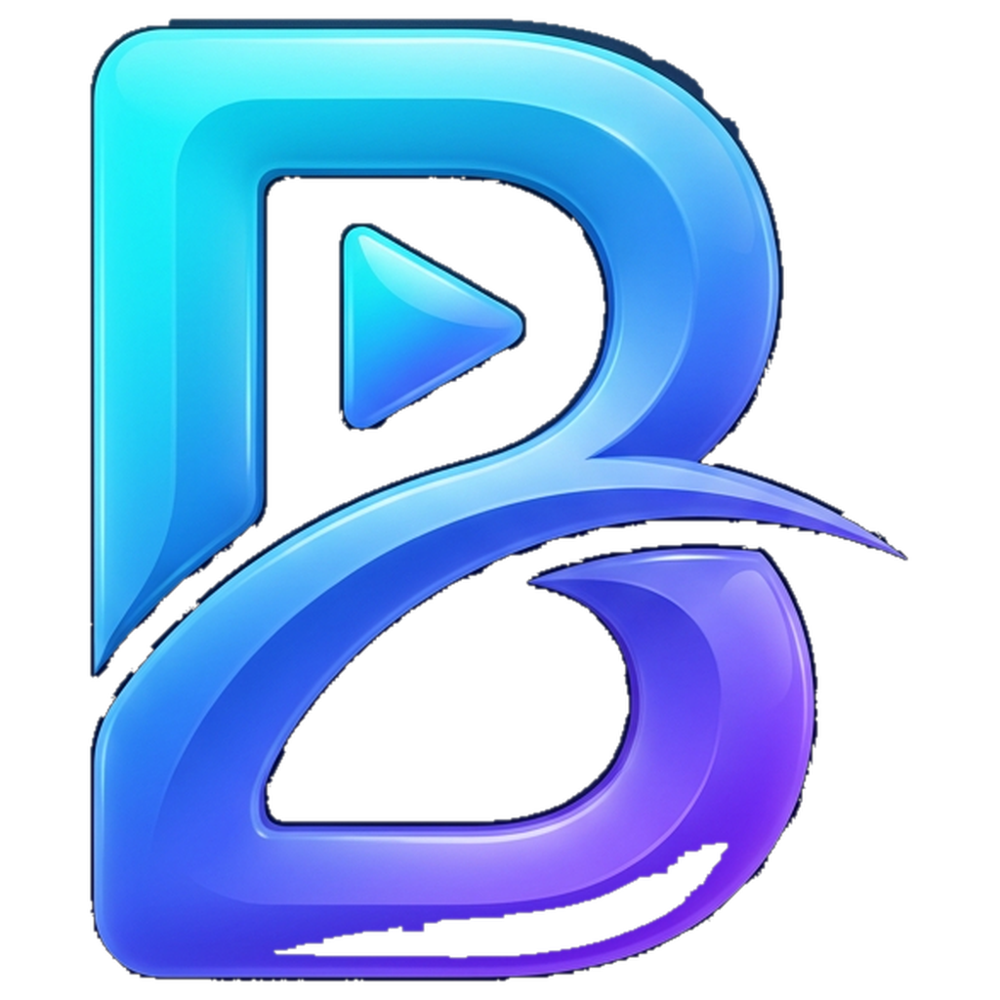

<p align="center">
  
</p>

<h1 align="center">StreamBridge</h1>

<p align="center"><strong>Your Media, Your Way</strong></p>

<p align="center">
  Android · iOS (sideload) · GPL-3.0 · version <strong>0.1.15</strong> (115)
</p>

StreamBridge is an independent media client. You connect your own catalogs, addons and
plugin sources; StreamBridge brings them together in one place with a player, a library,
watch progress, downloads and optional tracking.

It ships empty. There are no built-in catalogs, no bundled providers and no recommended
streams: what you see is what you configured. StreamBridge does not host, provide or
endorse any content. Use it only with material you are legally entitled to access.

## Highlights in 0.1.15

- **Complete core baseline sync** — the whole 0.6.7-beta core tree is integrated at source
  level (96 upstream commits across the whole changed file set), keeping every StreamBridge-specific
  implementation on top of it.
- **Glass UI (experimental)** — a new appearance preset family (dark, balanced, vivid) with
  edge-to-edge frosted headers on phones; headers now pin at the very top, and Search keeps
  Discover in a fixed header band.
- **App-wide background** — pick an image from your gallery or a URL and it is drawn once
  behind every screen; the dynamic-background and catalog-accent settings moved into
  Layout > Home.
- **Player** — resize the video beside the watch-party panel; the automatic source failover
  no longer loops after a source change; anime engine selection is fixed; the skip button
  keeps its timer running through segment-category changes.
- **Subtitles and audio** — addon-delivered ASS subtitles render through libass on Android
  again; subtitle addon requests carry file extras and compute OpenSubtitles-compatible
  hashes for local and P2P streams; reusing the last link now keeps the chosen stream info
  and the current-stream marker.
- **Continue watching** — mark an item as watched directly from its long-press menu.
- **Live TV, search and library** — Live TV pins its title, search and filter header; search
  and library draw one continuous header band with a pinned cloud toolbar.
- **iOS** — playback now declares the long-form-video audio session so it is no longer
  treated as music, MPVKit was updated for the host audio session, Now Playing publishes
  only on real playback changes, and the profile-insight photo picker opens after the native
  sheet closes.
- **Profile insights** — a frosted hero and glass-ready cards over the app background.
- **Translations** — Arabic, Bulgarian, Greek, Spanish, French, Italian, Polish,
  Brazilian Portuguese, Turkish and Vietnamese locales completed and harmonized.
- **Toolchain** — Gradle 9.8.2, the Android Gradle Plugin 9.4.0 line and compile SDK 37.1.
- **StreamBridge specifics** — the About Us entry regained its original icon and subtitle
  (restored verbatim from the original root-page row), and About Us gained a "Join our
  Discord" invitation row (https://discord.gg/T9apykrjW) next to the Telegram community
  channel.


## Features

**Home and discovery**
- Catalogs from your addons, Continue Watching, and configurable hero layouts
- Search, title details, trailers, and episode shuffle for series
- Collections and folders for organising what you keep

**Playback**
- Media3/ExoPlayer playback on Android, with an MPV path for formats ExoPlayer handles poorly
- HLS quality selection when a stream exposes master variants
- Gestures: tap-to-seek, pinch zoom, double-tap seek, brightness/volume swipes
- Picture-in-picture, background playback, and an optional external player
- Subtitle styling, per-episode restore, sync-by-ear alignment, and optional libass rendering

**Watch Party**
- Create a party from a title or join with a six-character code or a StreamBridge invite link
- Host-controlled or shared playback control, member list, and in-party chat
- Stream sharing between members when the host enables it

**Library and tracking**
- Library, calendar, lists and downloads
- Ratings and watch progress synced with Trakt, Simkl and MDBList
- Optional Trakt device-code sign-in and Simkl PIN/device sign-in
- AniList ratings alongside TMDB/IMDb sources

**Live TV**
- Channels, EPG and Live TV settings for the sources you configure

**Profiles and customisation**
- Multiple profiles with avatars, optional custom avatar URLs and GIF search
- Themes, navigation styles, poster cards and Liquid Glass toggles
- Profile insights computed off the main thread

**Downloads and cloud**
- Download manager with Wi-Fi-only and storage-location settings
- Cloud library playback for configured servers

**Plugins and extensions**
- Plugin and addon management, kept as separate settings sections
- Plugin runtime with asynchronous timers for Nuvio-compatible plugins
- CloudStream extension support in the sideload (full) distribution, including the
  embedded execution runtime

**Updates and privacy**
- In-app updates from the published GitHub Releases of `sascio/MyBridge` only
- A Privacy & Policy page describing what is stored locally and which services can be contacted

## Install

### Android

Production builds are the published GitHub Releases of this repository. Each release attaches one
APK per ABI plus a checksum file:

| File | Device |
|---|---|
| `androidApp-full-arm64-v8a-release.apk` | Most modern phones and tablets |
| `androidApp-full-armeabi-v7a-release.apk` | Older 32-bit devices |
| `androidApp-full-x86_64-release.apk` | x86_64 emulators / ChromeOS |
| `androidApp-full-x86-release.apk` | x86 emulators |
| `checksums.sha256` | SHA-256 of the four APKs |

Install the APK that matches your device. In-place updates require the same signing certificate,
so install future releases over the existing app rather than uninstalling it.

APKs built by branch CI are debug-signed compile artifacts, not production builds. See
[docs/SIGNING.md](docs/SIGNING.md) for the signing and verification model.

### iOS

iOS builds are published as an **unsigned** IPA on the
[published releases](https://github.com/sascio/MyBridge/releases):

- `StreamBridge-0.1.15-iOS-unsigned.ipa`

There is no App Store listing. Install it with **AltStore** or **SideStore**, which sign the IPA
with your own Apple ID on your device:

1. Install [AltStore](https://altstore.io) or [SideStore](https://sidestore.io) and complete its
   setup. Both work with a free Apple ID; AltStore needs AltServer on a computer on the same
   network, SideStore pairs once.
2. Add this repository as a source:
   `https://raw.githubusercontent.com/sascio/MyBridge/main/store.json`
3. Install StreamBridge from the source, or use "Install from file" with the downloaded IPA.

A free Apple ID signs for 7 days at a time; AltStore/SideStore refresh the app before it expires.
Free accounts are limited to 3 sideloaded apps and 10 new App IDs per week. A paid Apple Developer
account only changes those limits — the app is the same build.

`store.json` is regenerated from each published release by
`.github/workflows/update-store-source.yml`, so it always points at the real IPA of the newest
version, with its size and SHA-256. See [docs/RELEASE-IOS.md](docs/RELEASE-IOS.md).

## Build from source

Requirements: JDK 21, Android SDK with the platform/build-tools versions from
`gradle/libs.versions.toml`, and — for the libmpv/libass module — the Android NDK and CMake 3.22.1.

```bash
# Debug
./gradlew :androidApp:assembleFullDebug

# Release, one APK per ABI (debug-signed unless production secrets are configured)
./gradlew :androidApp:assembleFullRelease
```

Outputs land in `androidApp/build/outputs/apk/full/{debug,release}/`.

The Play Store flavor is built without the CloudStream execution runtime:

```bash
./gradlew :androidApp:assemblePlaystoreDebug -Pnuvio.android.distribution=playstore
```

iOS builds run on macOS:

```bash
./scripts/prepare-ios-dependencies.sh
./scripts/build-ios-ipa.sh
```

The IPA is written to `build/ios-ipa/` unsigned. See [docs/RELEASE-IOS.md](docs/RELEASE-IOS.md).

## Releases

- Android and iOS builds are produced independently from the same verified tag. The production
  release workflow creates a draft; it is not public until the release is explicitly published after
  checks pass. The unsigned iOS IPA can be attached after the Android assets without publishing a
  partial sideload source.
- The release workflow verifies the selected tag, app version and version code, and refuses to build
  assets when an existing tag points at a different commit. Existing release assets are checked by
  SHA-256 and are never clobbered.
- Production Android builds are signed with the StreamBridge upload key and fail closed if the
  signing secrets are absent. No debug-signed APK is ever attached to a release.
- Release notes and artifacts are listed on the
  [releases page](https://github.com/sascio/MyBridge/releases).

## Project layout

| Path | Contents |
|---|---|
| `composeApp/` | Kotlin Multiplatform app: shared UI and logic, Android and iOS source sets |
| `androidApp/` | Android application module, manifest, native libmpv/libass module |
| `iosApp/` | SwiftUI host, player bridge, Xcode project |
| `branding/` | Canonical StreamBridge marks |
| `docs/` | Signing, iOS release, CloudStream, upstream sync and parity documentation |
| `scripts/` | Asset optimisation, iOS packaging and sideload-source tooling |

## Privacy and network services

StreamBridge stores your profiles, library, watch progress and settings on your device. Some
optional features talk to services you enable:

- Your own addons and plugin sources, at the URLs you add.
- Your own media servers (Jellyfin/Emby-style), if you connect one.
- The account backend used for sign-in, profiles and sync. The default is the public
  `api.nuvio.tv` service operated by NuvioMedia; StreamBridge is not its operator, and a custom
  backend can be configured instead.
- Tracking providers you connect (Trakt, Simkl, MDBList), review services and supporter
  membership, only after you sign in.

Crash reporting is opt-in and can be disabled in Settings → Advanced. The in-app Privacy & Policy
page documents each category, and [NOTICE](NOTICE) lists the third-party components.

## Contributing

Issues and pull requests are welcome. Please keep changes buildable:
`:composeApp:check`, `:androidApp:assembleFullDebug` and `:androidApp:lintFullRelease` are the
minimum gates. Report security issues privately rather than in a public issue.

## Attribution and license

StreamBridge is licensed under **GPL-3.0** — see [LICENSE](LICENSE), [COPYING](COPYING) and
[NOTICE](NOTICE).

StreamBridge is an independent project maintained at `sascio/MyBridge`. It is not an official
Nuvio release and is not affiliated with or endorsed by NuvioMedia. Its core is derived from the
GPL-3.0 NuvioMobile and NuvioMobile-Enhanced projects; the exact pins, copyright holders and
license texts are recorded in [NOTICE](NOTICE) and the upstream parity notes in
[docs/upstream-parity-0.6.3.md](docs/upstream-parity-0.6.3.md). Portions of the optional
libmpv/libass subtitle renderer come from AIOStreams and remain under AGPL-3.0; see
`third_party/AIOStreams/`.

<p align="center"><sub>Made with ❤️ by Saif</sub></p>
